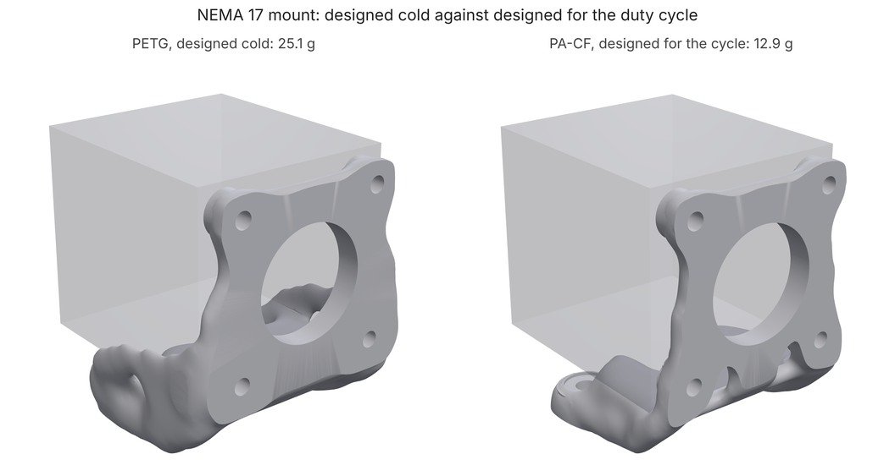
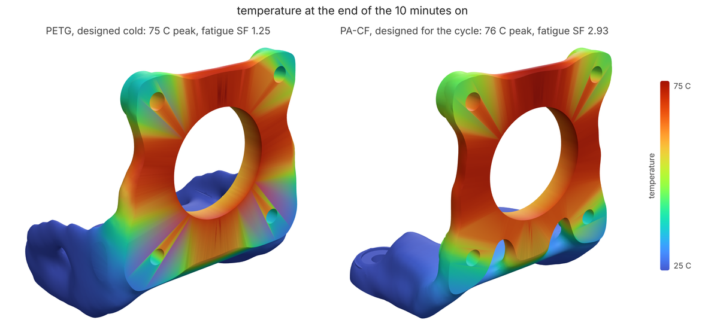

# Motor mount on a duty cycle: designing for the heat

**What you'll make:** a printed NEMA 17 mount for a belt-driven axis. Two M4
bolts hold it to an aluminium frame, the stepper bolts to its face with four
M3s, and the belts pull 100 N on it sideways or upwards. The stepper runs
hot: driven hard it puts about 1.5 W into the bracket through its face for
10 minutes, then rests for 10, about 30,000 times over the machine's life
(eight a day for ten years). You design it the usual way first, at room
temperature, in PETG; then check it under the duty cycle and find that its
face reaches 75 C, where PETG keeps a quarter of its stiffness, and that the
heating and cooling alone use up its fatigue margin. Then you run the study
with the heat in it, in carbon-filled nylon, and get a part that meets both
the static goal and the duty cycle at half the mass. About 20 minutes on 4
cores, 4 with `--quick`.



## The studies

[`mount-cold.json`](mount-cold.json) is the bracket as you'd first write it:
the design space beside the motor, the four motor pads and the pilot ring
kept solid, the motor body and the bolt and driver access kept clear, the
two bolts fixed and the frame under them pushing back, two belt load cases,
PETG, a safety factor of 3 and members no thinner than 3 mm.

[`mount.json`](mount.json) is the same study with the heat in it, two more
blocks (`loadpath schema study` documents both):

```text
"thermal": {
  "ambient": 25,
  "temperatures": [{"shape": {"type": "box", "min": [-25, -1, -1], "max": [25, 51, 0.6]}, "t": 25}],
  "heat": [{"shape": {"type": "cylinder", "p0": [0, -1, 35], "p1": [0, 1, 35], "r": 21}, "watts": 1.5}],
  "convection": 10,
  "cycle": {"period": 1200, "on": 600, "cycles": 30000}
},
"durability": {"safetyFactor": 1.5, "constrain": true}
```

- `temperatures`: the aluminium frame under the bracket holds its base at
  25 C (a big heat sink);
- `heat`: 1.5 W into the bracket through the motor's face (a disc over it);
- `convection`: 10 W/(m² K) off every other surface, still air;
- `cycle`: the heat is on for the first 600 s of every 1200 s, 30,000 times.
  The temperature is solved through the cycle (heat-up and cool-down with the
  material's heat capacity) to its repeating state, and the part is checked
  at its hottest and coldest moments;
- `durability`: the fatigue safety factor to hold, 1.5 on the stress
  (`constrain`: the search sizes the part for it, not only reports it).

At the hot moment every cell is checked with its modulus and strength
derated by the material's retention curve at its temperature (`loadpath
materials petg` shows the curve: 60% at 65 C, 25% at 75 C), and the
expansion that the cold base, the bolts and the part's own cooler material
stop becomes stress. Over the cycle that stress comes and goes, and that is
thermal-cycling fatigue: durability's design curve (PLA's, scaled by
strength, flagged `assumed` for PETG) read at the cycle's worst point, times
30,000.

[`mount-pa-cf.json`](mount-pa-cf.json) is `mount.json` in PA-CF (Bambu
PAHT-CF from the material library): it keeps more than half its stiffness
at 80 C, grows less than half as much as PETG per degree and is twice as
strong.

## 1. Design it cold

```bash
loadpath run mount-cold.json --out cold/
```

The lightest outcome that holds SF 3 at room temperature, as any study
without a `thermal` block would deliver it: **25.1 g, SF 3.54**.

## 2. Check the cold design under the duty cycle

```bash
loadpath verify mount.json cold/ --out cold-hot/
```

`verify` checks a finished part against a study: here, the cold-designed
part against the study with the heat in it. It prints `"passes": false`, and
`cold-hot/verify.json`'s `report` says why:

- `thermal`: the face reaches **75 C** at the end of the 10 minutes on
  (`maxTemperature`), PETG's stiffness there falls to 25% (`minRetention`);
  the base stays at 25 C, so the part swings 48 C every cycle;
- `cases`: the static check still passes, SF 4.4 at the hot moment, because
  the worst static stress is at the bolts, which stay cool;
- `durability.thermalCycling`: at the face's edge, where the hot plate meets
  the cooler wall that holds it, the stress swings with the temperature
  every cycle (8.1 MPa read against room-temperature strength); that spot
  lasts about 100,000 cycles, and the **fatigue safety factor is 1.25**
  against the 1.5 the study asks for (`fatigueSafetyFactor`). The part would
  likely make its 30,000 cycles, but without the margin a design curve for
  an assumed material calls for.



## 3. Design it with the heat

```bash
loadpath run mount-pa-cf.json --out hot/
```

Now the optimizer solves the part's temperature every iteration and designs
for its hot moment (softened cells, expansion as a load), and the search
checks every outcome under the whole cycle. `hot/report.json`'s best outcome
is **12.9 g, SF 3.33** at the hot moment, **fatigue SF 2.9**, face at 78 C.

## What you should see

Full grid, as the commands above run:

| | mass | SF, room temperature | SF, hot moment | hottest | thermal-cycling fatigue SF | passes |
|---|---|---|---|---|---|---|
| PETG designed cold (`cold/`, then `cold-hot/`) | 25.1 g | **3.54** | 4.4 | 75 C | **1.25** (life ~100k cycles) | no |
| PA-CF designed for the duty cycle (`hot/`) | **12.9 g** | | **3.33** | 78 C | **2.9** | yes |

The cold check said the PETG mount had 3.5x margin; under the duty cycle its
margin on fatigue is 1.25 against the 1.5 asked, set by the face's own
expansion, not by the belts. The PA-CF part is half the mass and meets both,
mostly because of the material: at its hot spot the cycle's stress is about
the same, 8 MPa, but PA-CF is twice as strong and still keeps more than half
of it at 78 C, so its fatigue strength is 23 MPa against PETG's 10. The
`thermal` block is what tells you that and sizes the part for it; without
it, nothing in the cold run would have said the PETG part was short.

Designing the PETG part with the heat in it does not rescue it (shown, not
run by the tests: half an hour on 4 cores):

```sh
loadpath run mount.json --out hot-petg/
```

Every outcome it tries reads SF 2.0-2.3 at the hot moment and a fatigue SF
of 0.5-0.6 (23.7 g at a fixed volume fraction of 0.27; 26.6 g and 36.3 g in
the search), worse than the cold design. The optimizer minimizes compliance,
and with expansion in the load that rewards opening holes in the hot face
plate (less material fighting the expansion), which leaves thinner, hotter
ligaments carrying the belts: stiffer overall, more stressed where it is
softest. For a hot PETG part, use the `thermal` block to check the design and
pick the material; don't count on it to design the hot spot away.

Things to know:

- **The temperature model is simple.** 1.5 W is an assumption (a stepper's
  losses are a few W, most of them to the air and the shaft); measure the
  motor face with a thermocouple and set `heat` until the bracket's face
  matches it, or hold the face at the measured temperature with
  `temperatures` instead.
- **The fatigue numbers are estimates.** No printed-PETG or PA-CF thermal
  fatigue data were found, so the reading is the mechanical design curve at
  the thermal stress (loadpath/durability.py); treat a factor of 1.25 as a
  warning, not a life.
- **The mount is treated as an ideal solid** (`"process": "none"` in the
  studies), to keep this tutorial about heat. Left out, the process is taken
  from the material (FDM for PETG and PA-CF) and the mount is designed for
  its layer bonds and overhangs in the direction loadpath chooses: heavier,
  and what you would print.
- **The bolts relax too.** PETG near 75 C creeps under a bolt's clamp; add a
  `durability.preloadHours` and fasteners to see it, or put metal inserts in
  the pads.

## Quick mode

The same commands with `--quick` (or `LOADPATH_QUICK=1`) run each study on
6000 cells and 30 iterations, about 3 minutes in all. The cold design comes
out lighter (21 g) and reads worse under the cycle (fatigue SF about 1.0, a
life a little under the 30,000 cycles); the PA-CF design comes out at 13.7 g,
fatigue SF about 3.8. That reading is a hot-spot one and swings with the
mesh: the same search with members smoothed a little thinner (before
01d680f, which holds them to minMember) delivered 13.9 g at fatigue SF 2.3,
and its lighter 9.6 g outcome read 2.7. So expect.json bounds it at 1.5
(the study's target) to 4.5, and the mass band is what catches a part
built heavier than it needs. CI runs this
tutorial that way ([test_tutorials.py](../../../tests/test_tutorials.py))
and holds it to [expect.json](expect.json).

The images come from [render.py](render.py) after a full run (three.js in
headless Chromium via [docs/render3d.py](../../render3d.py)).
