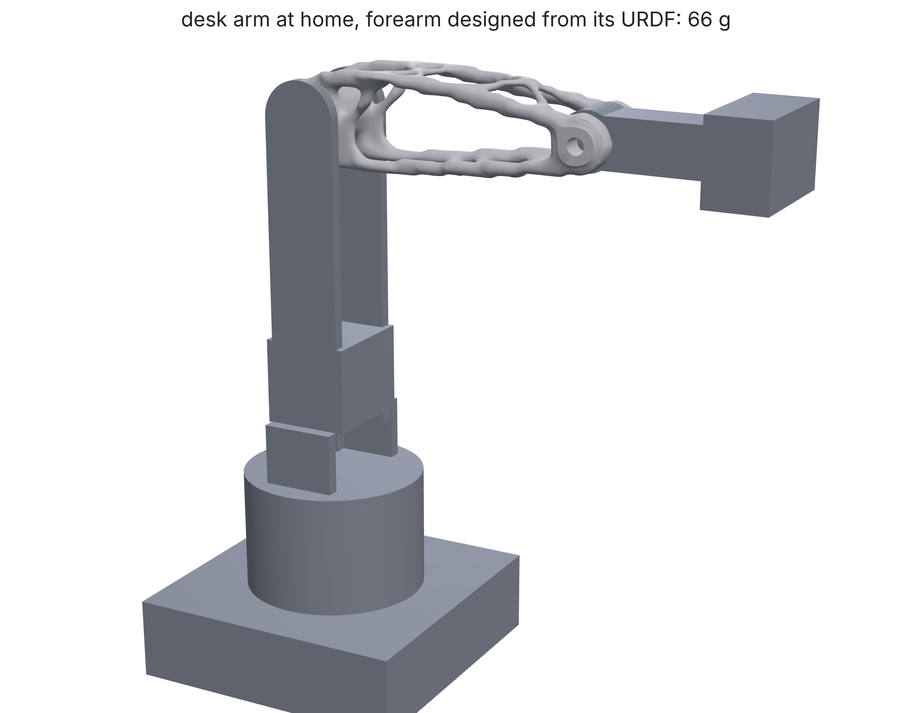
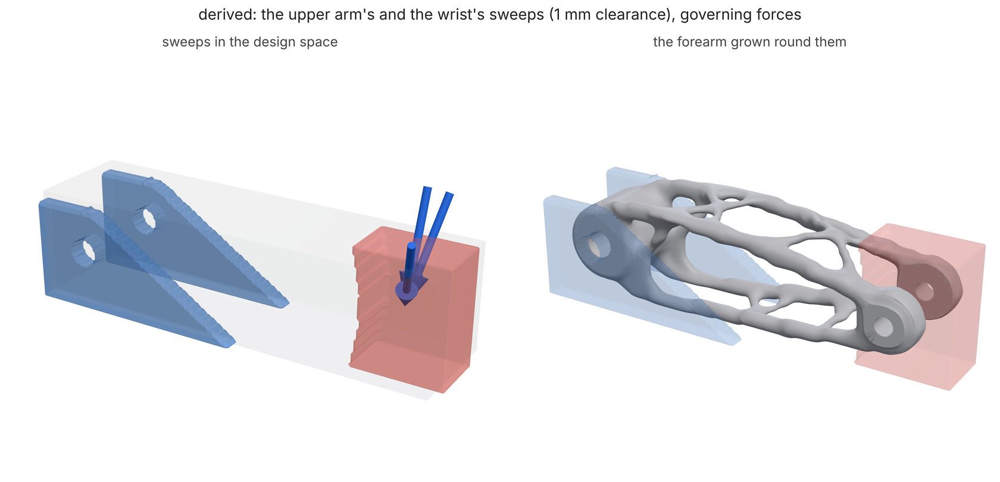
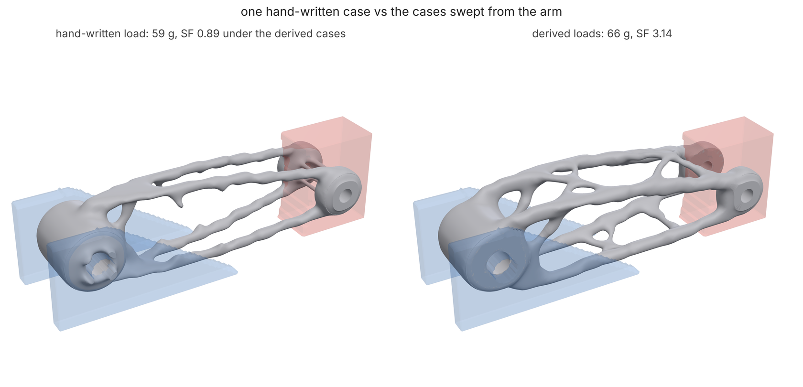

# A robot arm link, loaded by its own URDF

You'll design the forearm of a small four-axis desktop arm (GRIP-sized: base
yaw, shoulder, elbow, wrist pitch, 1 kg at the gripper) in SLS PA12 to a
safety factor of 2, without writing its loads by hand. The arm's URDF
already knows what the forearm carries: masses, joint ranges, speed and
torque limits. `loadpath assembly` sweeps the arm through thousands of
states (poses, motion at the drives' limits, a push at the tool, a joint
stalled against an obstacle), keeps the few that set the forearm's stress
everywhere, and sweeps the neighbouring links (the upper arm and the wrist)
through their joints' ranges so the part leaves room for them. Then
`loadpath run` designs the part from that derived study. At the end you'll
see what the usual hand-written case ("1 kg at full reach, times 2") would
have got wrong.



## Files

| File | What it is |
| --- | --- |
| `robot.urdf` | The arm: five links, four revolute joints (`j1` yaw, `j2` shoulder, `j3` elbow, `j4` wrist), masses, inertias, limits, and collision boxes and cylinders for the neighbours' shapes |
| `forearm.json` | The forearm's study: its interfaces, material, goal and design space, with one hand-written load case |
| `render.py` | Draws the pictures in this page from your outputs (not run by the tests) |

`forearm.json` is drawn in the URDF's world frame at the home pose (every
joint at 0), in mm: the elbow axis `j3` is at (0, 0, 280) and the wrist axis
`j4` at (140, 0, 280), both along y. What the study fixes:

- **design space**: a 184 x 48 x 48 mm box round the two axes;
- **elbow**: a 32 mm diameter hub between the upper arm's cheek plates (`elbow-hub`,
  preserved), clamped on a 12 mm shaft (`elbow-shaft`, a keep-out and the
  **support**);
- **wrist**: two cheeks (`wrist-cheek-left/right`, preserved) either side of
  the wrist's hub, on an 8 mm pin (`wrist-pin`, a keep-out and the **load
  region**: whatever the wrist and the payload do arrives here);
- a 9 mm `cable-channel` down the middle;
- `"material": "pa12"`, `"process": "sls"`, `"goal": {"safetyFactor": 2.0}`,
  3 mm minimum member, mirror-symmetric about y = 0.

Its one load case, `reach-x2`, is what you might write by hand: the payload
and the wrist hanging off the pin with the arm stretched out, doubled for
motion (25.5 N down and 1864 N·mm about the pin).

## 1. Derive the loads and keep-outs from the arm

```bash
loadpath assembly robot.urdf --link forearm --study forearm.json --region wrist-pin \
    --payload 1 --payload-at 0.08,0,0 --out derived/
```

`--link forearm` is the URDF link the study designs; its far joint (`j4`)
is where the load comes in, and `--region wrist-pin` is the study region
that stands for it. `--payload 1 --payload-at 0.08,0,0` puts 1 kg 80 mm out
from the wrist axis, in the wrist link's frame (metres, as in the URDF).
About a minute; it writes:

- `derived/forearm.derived.json`: `forearm.json` with its load case replaced
  by the derived ones and the swept keep-outs added;
- `derived/sweep-upper_arm.stl`, `derived/sweep-wrist.stl`: the swept
  neighbours;
- `derived/assembly.json`: what was swept and picked, with the arm's state
  for each case.

What it did:

- **Load sweep.** 1500 random poses over the joint limits plus every
  corner and midpoint of the limit box, each one (a) at rest with a 0-1 kg
  payload, (b) moving with every joint near its speed limit and
  accelerating to full speed in 0.2 s (`--ramp`), cut back to what each
  joint's rated `effort` can deliver, (c) with a 20 N push at the tool in a
  random direction (`--push`), only as hard as the joints can hold, and
  (d) with each joint upstream stalled at its rated torque against an
  obstacle at the tool. For every state, Newton-Euler over the wrist and the
  payload gives the exact force and moment the forearm carries at `j4`,
  turned into the forearm's frame at home. About 5,800 states in all.
- **Governing cases.** Six unit-load solves on the solid design space give
  every state's stress in every cell. A greedy pick keeps the states that
  bring each cell within 5% of its worst over the whole sweep, here three
  cases, all `push`: the payload held with the tool pushed sideways and
  down. `assembly.json` says how close the three come to the full sweep
  (`envelopeRatio`: 5th percentile of the most-stressed fifth of the part,
  0.89 of its worst) and the joint angles of each (`states`).
- **Swept keep-outs.** The parent (the upper arm, through `j3`'s range)
  and the child (the wrist, through `j4`'s range) are taken from the URDF's
  collision shapes and swept in the forearm's frame, grown by 1 mm
  (`--clearance`), less the forearm's own preserved hub and cheeks. The
  upper arm's cheek plates sweep under the elbow (44 cm³); the wrist's hub
  and stem sweep a fan round the wrist pin (54 cm³) that the forearm must
  straddle.



The three derived cases next to the hand-written one (N, N·mm, at the pin):

| Case | Force | Moment | Arm state |
| --- | --- | --- | --- |
| `reach-x2` (hand) | (0, 0, -25.5) | (0, 1864, 0) | stretched out, x2 |
| `sweep-0-push` | (0.4, -10.4, -27.8) | (383, 1904, -741) | 20 N push, 0.87 kg |
| `sweep-1-push` | (-7.0, 13.8, -22.7) | (10, 1740, 1105) | 20 N push, 0.67 kg |
| `sweep-2-push` | (-4.1, -13.7, -26.0) | (-132, 2018, -1090) | 20 N push, 0.93 kg |

The vertical load is about what the hand-written case guessed. What it
missed is the side load: 10-14 N across the arm and up to 1.1 N·m about
the vertical, which bends the forearm the way it is thinnest.

## 2. Design the forearm from the derived study

```bash
loadpath run derived/forearm.derived.json --out out/
```

The derived study names its sweeps by file name beside it, so it runs from
any folder. About 20 minutes on 4 cores. The search tries six volume
fractions and keeps the lightest that passes: 66 g at SF 3.14 (3.23 on the
150,000-cell confirmation grid), with every derived case at SF 3.1 or more
(`out/report.json`, `outcomes[best].cases`). The next one down, 64 g,
read SF 1.44. The part is `out/forearm-13.stl`, with a picture beside it.

It is a hollow frame, perforated top, bottom and sides, which is what a
load that swings from vertical to sideways asks for. It stays out of both sweeps: narrow under the elbow where
the upper arm's cheek plates swing up, and split into two cheeks round the
wrist's swing.

## 3. Compare: the hand-written load case

```bash
loadpath run forearm.json --out hand/
loadpath verify derived/forearm.derived.json hand/ --out hand-check/
```

The first designs the forearm from `reach-x2` alone (about 15 minutes):
58.6 g at SF 2.80, a pass. The second checks that part (a run folder is
read as its best outcome) against the derived study, its three cases and
its swept keep-outs, and writes `hand-check/verify.json`:

| Case | SF | Deflection |
| --- | --- | --- |
| `sweep-0-push` | **0.89** | 10.6 mm |
| `sweep-1-push` | 1.16 | 14.2 mm |
| `sweep-2-push` | 0.98 | 14.0 mm |

It breaks under a 20 N push the arm can hold, and 4.5 cm³ of it is where
the neighbours swing: 2.0 cm³ in the upper arm's sweep under the elbow and
2.5 cm³ in the wrist's. Optimized for a vertical load, it put its material
in two thin trusses in the arm's vertical plane, with little to resist
sideways bending or twist; the derived part spends 7 g more on the top and
bottom that do.



## What you should see

Full grid (no `--quick`), 4 cores, about 40 minutes for all four commands:

| | Mass | SF (goal 2) | Passes | Notes |
| --- | --- | --- | --- | --- |
| Derived cases (`derived/assembly.json`) | | | | 3 cases, all `push`; 0.89 of the sweep's worst stress (p5, top 20% of cells) |
| Swept keep-outs | | | | upper arm 44 cm³, wrist 54 cm³ |
| Derived study (`out/`) | 66.0 g | 3.14 | yes | lightest of six outcomes that passes |
| Hand-written case (`hand/`), its own case | 58.6 g | 2.80 | yes | |
| Hand-written part under the derived study (`hand-check/`) | 58.6 g | **0.89** | **no** | 10-14 mm deflection; 4.5 cm³ inside the sweeps |

## Quick mode

The tests run these commands with `LOADPATH_QUICK=1` (or add `--quick`):
150 sampled poses instead of 1500, about 6,000 cells, 30 iterations, three
outcomes searched, and `verify` on 20,000 cells. All four commands take
about four minutes. The sweep is smaller, so the governing cases can come
out as stalls instead of pushes, and the numbers move: read a quick run for
direction.

## Make it yours

- Your arm: point `assembly` at its URDF, name the link and the region
  where its far joint's load arrives. Collision meshes, or boxes, cylinders
  and spheres, become the neighbours' shapes.
- `--samples`, `--ramp`, `--push`, `--contact-max`: what the controller
  commands and what the arm can meet. These are the inputs worth
  questioning first.
- `--balanced j2`: a spring carries that joint's static weight.
- `--keep-cases` keeps the study's own cases beside the derived ones.
- `--no-space` derives loads only.

The pictures come from `python render.py` (three.js in headless Chromium
through `docs/render3d.py`), run in this folder after the full-grid
commands.
