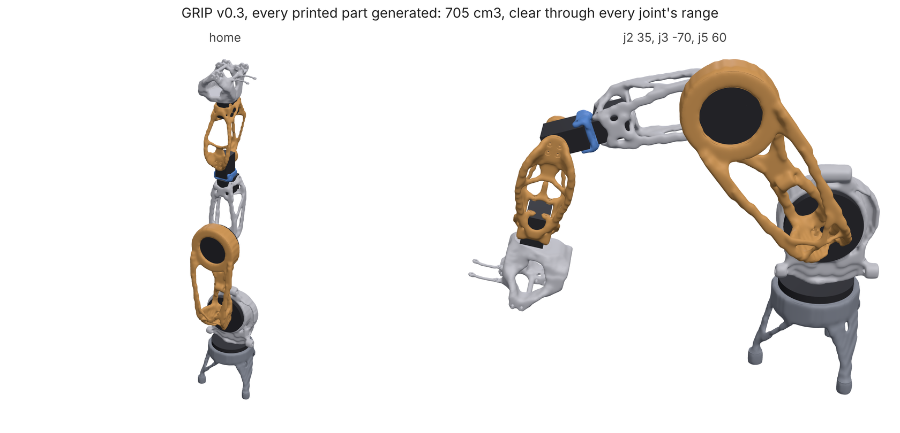

# GRIP v0.3 links

The five structural links of [GRIP](https://github.com/connorwhite-online/grip),
a 6-axis printed robot arm, as loadpath studies. GRIP is loadpath's standing
test subject: real interfaces (servo cradles and their screw bosses, horn hubs,
cycloidal-drive sockets with hex-driver access to every bolt, a J2
counterbalance spring) and real loads (statics over the arm's URDF at full
reach with 1 kg at the gripper and a 1.5x dynamic factor, each joint above at
its rated torque, a 20 N push along its axis). Goal: SF 2 in SLS PA12-GF.

`studies/` is copied verbatim from GRIP's `generative/v3/studies/` (branch
`generative-redesign`, commit 3689f8d; wrist yoke and wrist link from de445fd, written by `generative/v3.py`). GRIP is
CERN-OHL-W-2.0; these study files describe its parts.

```bash
python examples/grip/run.py                         # regrow all five, re-verify, close-ups
python examples/grip/run.py --links wrist_yoke      # ~25 min on 4 cores
python examples/grip/run.py --verify-only DIR       # check DIR/<link>.stl
```

Each link is re-verified on a 150k-cell grid and drawn close up at every
interface (`render.render_interfaces`); `scorecard.json` has mass, SF with the
peak's location per case, ray member thickness, crease length, sawn-off area,
keep-out intrusion and lost preserved geometry.

## What GRIP recorded vs loadpath main (2026-10-29)

"Recorded" is GRIP's v0.3 summary (the study's own check at delivery).
"Regrown" is the study run again on main at 8de87b2 and checked the way
the study's confirm stage checks it: 150k cells, with stress within one
optimization cell of a load or support left out of the peak. The turret
was regrown on main with the closing fillet as the grip-turret eval case.

| Link | Recorded | Regrown on main | Ray p5 member | Crease | Notes |
| --- | --- | --- | --- | --- | --- |
| Turret | 236 g, SF 2.41 | 257 g, SF 2.25 | | 139 mm | eval case grip-turret |
| Upper arm | 179 g, SF 2.81 | pending | | | GRIP's part has ~1070 mm² sawn flat on the design box |
| Forearm | 78 g, SF 4.19 | **57 g**, SF 2.54 | 3.24 mm | 3 mm | |
| Wrist yoke | 24 g, SF 4.41 | 24 g, SF 4.35 | 2.97 mm | 26 mm | overbuilt; eval case grip-wrist-yoke asks for 20 g |
| Wrist link | 67 g, SF 4.13 | **52 g**, SF 2.96 | 2.24 mm | 0 mm | thinnest members under the 3 mm minimum |

### Fixed in GRIP de445fd: no room for the servo horn

GRIP's `servo_child` kept the horn bolts and their drivers clear but not
the horn itself (0–4 mm above the servo's horn face) or the servo body the
child turns round. Every wrist yoke up to then, GRIP's printed one included,
was solid across the J4 horn disc from about 1.5 mm above the face
(~900 mm³), and the yoke regrown above cut ~900 mm³ into the J4 servo's
roll sweep. The wrist yoke and wrist link studies here now carry the fix
(a horn keep-out, the roll sweep for J4/J6, the home-pose body for J5);
their regrown numbers above predate it. Regrown with it on main at 42acf0b:
wrist yoke **19.3 g**, SF 4.15, crease 3 mm, no closed bores; wrist link
55.3 g, SF 4.71, ray p5 3.29 mm.

That yoke showed the next layout problem: its horn hub was squeezed to
1.9 mm, because the J5 servo (hanging 33.7 mm below its shaft) started 1.9 mm
above the horn's top. GRIP 07aa65f moves J4's horn face 3 mm down its own
axis (z_j5 − 43, no kinematic change; the forearm gives up 3 mm). Regrown
on main at 0344844 with both fixes: wrist yoke 27.5 g, SF 4.07, ray p5
3.6 mm, no creases, no closed bores; forearm 82.8 g, SF 3.01 (heavier than
the 57 g it came to at 40 mm; the search settled on a stiffer outcome).

### Clearance volumes are not bores

The drive housings, the space below a hub, a child's or horn's swing, the J5
idler bearing seat and the spring's run and cable are marked `"bore": false`:
room to keep clear that material may close by design, so the closed-bore
check skips them. Screw, bolt, driver and pin bores stay checked.

## The TPU finger (`finger.py`)

GRIP's hand closes three TPU fingers with one tendon. `finger.py` curls
`hand/finger.stl` (from GRIP's `hand.py`) with `loadpath.nonlinear`'s tendon
loads: a cable at constant tension through guides along its channel to the
knot. On main at 37f5ac8, 0.73 mm cells: 48° of distal curl at 7.5 N, 120° at
16.7 N with 15 mm of cable pulled in. Three cells across the 2.2 mm flexure
make it about 2x too stiff; `--pitch 0.55` takes that out.

## Loads from the arm (`derive.py`)

The studies above carry GRIP's hand-written loads: one pose at full reach
times 1.5, the joint above at its rating, and 20 N along the joint's axis
applied at the socket. `derive.py` replaces them with loads swept from
GRIP's URDF by `loadpath.assembly` (v0.3 servo masses and efforts, J2's
static weight on its spring): about 11,000 states per link (limit corners
and random poses; the same poses moving at up to the URDF speed limits with
0.2 s ramps, cut back to what each joint's rated torque can deliver; a 0-1 kg
payload scattered 30 mm round the tool point; a 20 N push at the tool in any
direction; each upstream joint stalled against an obstacle at the tool, up
to 20 N), collapsed to two or three governing cases on the solid design
space.

GRIP's committed v0.3 parts, verified on main (150k cells) under both sets.
The old-load numbers match GRIP's recorded ones (forearm 4.2 vs 4.19).

| Link | Mass | SF, hand-written loads | SF, derived loads | Governing derived case |
| --- | --- | --- | --- | --- |
| Turret | 236 g | 2.67 | 2.13 | dynamic |
| Upper arm | 179 g | 2.81 | **0.93** | dynamic, 3.9 mm deflection |
| Forearm | 78 g | 4.20 | **0.69** | dynamic, 2.3 mm |
| Wrist yoke | 24 g | 2.89 | **0.61** | dynamic (J3 stall close behind) |
| Wrist link | 67 g | 4.23 | 1.72 | dynamic |

The peak loads are not much bigger (on the solid upper-arm space the
derived worst case is 1.35x the hand-written worst; at 0.5 s ramps, 1.17x,
the same as a 20 N push at the tool). What changes is direction: every
hand-written case loads the links in the arm's plane, while J1 swinging the
arm, or a push at the tool from the side, bends them out of it, about the
axis the optimizer was never asked to make stiff. Regrowing from
`<link>.derived.json` is the fix; the inputs worth questioning first are the
ramp (what the controller really commands) and the 20 N contact.

```bash
python examples/grip/derive.py --grip ../grip                  # derive + verify, ~1 h on 4 cores
python examples/grip/derive.py --grip ../grip --space --no-verify   # + neighbours' swept keep-outs
```

With `--space` the parent and child (GRIP's committed parts) swept through
their joints' ranges become keep-outs (1 mm clearance). The committed wrist
yoke has 3.5 cm³ inside the wrist link's J5 swing and the wrist link 2.4 cm³
inside the yoke's: the clash a fixed split of the space round J5 was
holding apart. The forearm and yoke overlap by under 0.1 cm³ round J4, and
the turret, upper arm and forearm are clear of their neighbours.

## The whole arm, regrown and checked together



Every printed part of the arm: the five links regrown under the derived loads
(`run.py --loads derived`, with lifetime cycles by case kind), and the base
and palm from GRIP's `v3_rest.py`. 705 cm³ against 857 cm³ shipped (-18%),
each part at SF 2.08 or more:

| Part | Shipped | Regrown | SF |
| --- | --- | --- | --- |
| Base | 189.0 cm³ | 124.8 cm³ | 5.37 |
| Turret | 205.2 cm³ | 174.6 cm³ | 2.59 |
| Upper arm | 176.6 cm³ | 182.7 cm³ | 2.08 |
| Forearm | 90.0 cm³ | 76.8 cm³ | 2.37 |
| Wrist yoke | 77.8 cm³ | 10.6 cm³ | 2.35 |
| Wrist link | 80.0 cm³ | 42.9 cm³ | 3.42 |
| Palm | 38.4 cm³ (gripper palm) | 92.7 cm³ | 4.25 |

GRIP's `assembly_check.py` (manifold booleans of every part against every
other and against the drives, servo bodies and horns, at home and through
each joint's URDF range in 10° steps) finds no overlap. The wrist link's
J5 keep-out `studies/j5-parent-sweep.stl` is the yoke's allowed space and the
J5 servo swept through ±100°; a flat split between the two left the link
6-60 mm³ inside the yoke at -100°.
